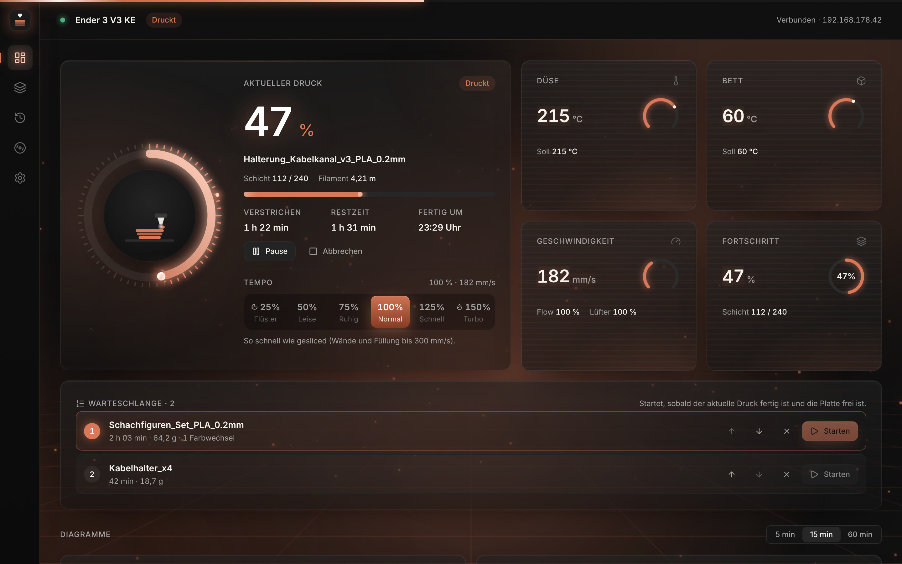
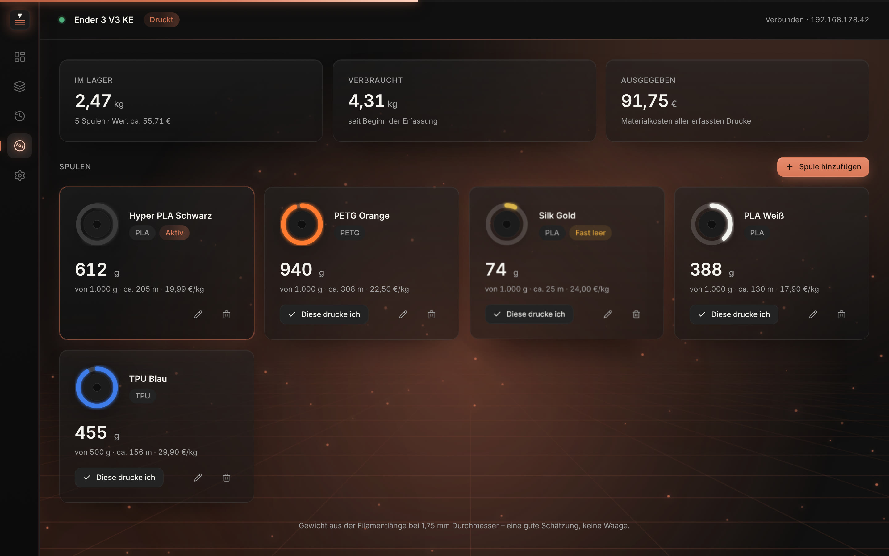

# Druckerwacht

🇬🇧 [English](README.md) · 🇩🇪 **Deutsch**

**Die kostenlose Komplett-App für deine 3D-Drucker: überwachen, slicen und steuern per WLAN – gemacht für den Creality Ender 3 V3 KE, und sie steuert auch K1, Klipper-, OctoPrint- und Prusa-Drucker.**
Open Source (AGPL-3.0) · **Windows, macOS und Linux** · Deutsch, Englisch, Spanisch, Französisch und Polnisch

[**⬇ Download**](https://github.com/pk1310oo/druckerwacht/releases/latest) · [Website](https://pk1310oo.github.io/druckerwacht/) · [Fehler melden / Wünsche](https://github.com/pk1310oo/druckerwacht/issues) · [Mitmachen](CONTRIBUTING.md) · [☕ Auf Ko-fi unterstützen](https://ko-fi.com/prisma76863)



## Was die App kann

**Überwachen**
- Live-Dashboard: Düse und Bett mit leuchtenden Anzeigen, Geschwindigkeit, Flow, Lüfter, Schicht, Restzeit und echte **Fertig-Uhrzeit**
- Live-Diagramme über 5, 15 oder 60 Minuten, Druckverlauf direkt vom Drucker, **Statistik** (Erfolgsquote, Druckstunden pro Woche)
- Benachrichtigungen am Computer – und auf Wunsch **aufs Handy** über die kostenlose App ntfy (fertig, Fehler, pausiert, nächster Druck wartet)
- **Mac-Menüleiste:** Fortschritt und Fertig-Uhrzeit direkt neben der Uhr
- **Handy im WLAN:** QR-Code scannen und alle Drucker live im Handy-Browser sehen – mit Pause, Fortsetzen, Abbrechen, Tempo und Licht, ganz ohne App
- **Druckerfehler in Klartext** und ein **Wartungsplaner**, der nach Druckstunden an Platte reinigen, Schienen schmieren oder Riemen prüfen erinnert

**KI-Fehlerwächter**
- Erkennt Spaghetti und abgelöste Drucke im Kamerabild und **pausiert automatisch** – läuft komplett auf deinem Computer mit dem offenen Obico-Modell, ohne Cloud und ohne Abo

**Kalibrieren wie ein Profi**
- Temperatur-, **Fluss-**, **Rückzugs-** und **Tempo-Turm** plus **Erste-Schicht-Test** – die App baut das Modell und schreibt die Werte in den G-Code; den besten Block anklicken und der Wert landet im Profil
- **Gemerkter Z-Offset**: erste Schicht einmal einstellen, ab dann bei jedem Druck automatisch
- **Filament-Assistent** mit bewährten Startwerten (PLA, PETG, TPU, ABS, ASA …) und **Dauer-Vergleich** für 50–150 % Tempo

**Viele Drucker**
- Creality (Ender 3 V3 KE, K1, K1C, K1 Max), jeder **Klipper**-Drucker mit Moonraker (Voron, Sovol, Elegoo Neptune 4, Qidi …), **OctoPrint** (praktisch jeder Marlin-Drucker) und **Prusa** über PrusaLink (MK4, MK3.9, Core One, Mini, XL)
- Die Netzwerksuche findet alle; jeder Drucker wird gleichzeitig überwacht, Umschalten mit einem Klick

**Steuern**
- Pausieren, Fortsetzen, Abbrechen
- **Werkzeug-Karte:** Referenzfahrt, **Bett-Leveling mit Speichern**, **PID-Kalibrierung**, Vorheizen (PLA/PETG/ABS/TPU), Filament laden/entladen, Z-Offset während der ersten Schicht, Lüfter, Licht, Motoren aus
- Beliebige fertige G-Code-Dateien senden und drucken
- **Modelle finden** auf Printables, Thingiverse und MakerWorld – der Download landet direkt auf der Platte
- **Nochmal drucken** aus dem Verlauf mit einem Klick – die App behält eine Kopie deiner letzten 15 Drucke
- **Nachtmodus:** zwischen 22 und 7 Uhr leise mit 50 %, morgens zurück aufs eigene Tempo
- **Tempo live** von 25 % *Flüster* bis 150 % *Turbo* – die erste Schicht bleibt immer bei höchstens 50 mm/s, damit sie haftet
- **Warteschlange:** geslicete Drucke vormerken und den nächsten mit einem Klick starten, sobald die Platte frei ist

**Slicen**
- OrcaSlicer-Motor mit den offiziellen KE-Profilen, alle Einstellungen, Schichtvorschau
- Stützen und Naht malen, schneiden, messen, mehrere Teile per Rechteck auswählen
- **Farbwechsel:** beliebige Schichten markieren – dort pausiert der Drucker für das nächste Filament
- **Temperaturturm** mit einem Klick: die App baut das Modell und schreibt den Temperaturwechsel in jeden Block
- Der Drucken-Dialog zeigt, **wann der Druck fertig** ist – mit 🌙, wenn das mitten in der Nacht wäre

**Filament-Lager**
- Deine Spulen mit Rest, Metern und Preis pro kg
- Jeder Druck wird automatisch abgezogen, die **Kosten pro Druck** stehen schon vor dem Drucken fest
- Warnt dich, **bevor** eine Spule mitten im Druck leer wird



**Komfort:** **Sprachansagen** (Start, 25/50/75 %, Farbwechsel, fertig) · **Druck-Kalender mit Stromkosten** · **Teilen-Bild** fertiger Drucke für Instagram & TikTok · Beim ersten Start sucht die App das Netzwerk ab und richtet den Drucker mit einem Klick ein · **Sichern & Wiederherstellen** aller Drucker, Einstellungen, Spulen und Wartungsstände.

**Optik:** ruhiges Neon-Gitter im Hintergrund, leuchtender Fortschrittsring, 3D-Karten, sieben Farbthemen – oder Effekte auf *Dezent* für langsamere Rechner.

**Installation:** Windows-Installer (`…_x64-setup.exe`, bei SmartScreen „Weitere Informationen → Trotzdem ausführen“), Mac-`.dmg` (danach einmal `xattr -dr com.apple.quarantine /Applications/Druckerwacht.app` im Terminal) oder Linux-`.deb`/AppImage – alles unter [Releases](https://github.com/pk1310oo/druckerwacht/releases/latest). Für den Slicer zusätzlich das kostenlose [OrcaSlicer](https://github.com/SoftFever/OrcaSlicer/releases) installieren; Druckerwacht findet es von selbst.

Gebaut mit Tauri 2, React und TypeScript, das Backend ist in Rust geschrieben.

> **Beta:** Die Schnittstelle des Druckers ist nicht offiziell dokumentiert; Rückmeldungen vom echten Gerät sind sehr willkommen.
> Druckerwacht ist kein offizielles Creality-Produkt.

---

## 1. Erster Schritt am echten Drucker: Mitschnitt (wichtig)

Die Schnittstelle (`ws://<IP>:9999`, dieselbe wie bei Creality Print) ist **nicht dokumentiert**.
Der Parser kennt die Feldnamen, die von der K1/KE-Familie öffentlich bekannt sind. Gegen **deinen** Drucker muss er aber noch geprüft werden.

Voraussetzung ist Node.js ab Version 22. Pakete werden nicht benötigt.

```bash
node scripts/probe.mjs --scan                 # Drucker im Netz finden
node scripts/probe.mjs 192.168.178.42 600     # 10 Minuten mitschneiden, am besten WÄHREND eines Drucks
```

Das Skript speichert alle Nachrichten in `probe-<ip>-<zeit>.jsonl` und listet am Ende jedes gefundene Feld mit Beispielwerten auf.
Es sendet nur zwei Dinge: eine Leseanfrage (`reqPrinterPara`) und die Antwort `ok` auf Heartbeats. Wer gar nichts senden will, hängt `--passive` an.

**Stand des Abgleichs** (Ender 3 V3 KE, Modell `F005`, Firmware V1.1.0.17, Mitschnitt im Leerlauf, siehe `src-tauri/fixtures/ke-idle.jsonl`):

| Anzeige | Schlüssel | Status |
|---|---|---|
| Düse Ist/Soll | `nozzleTemp`, `targetNozzleTemp` | ✅ bestätigt |
| Bett Ist/Soll | `bedTemp0`, `targetBedTemp0` | ✅ bestätigt |
| Max. Temperaturen | `maxNozzleTemp` (300), `maxBedTemp` (100) | ✅ bestätigt |
| Datei / Fortschritt | `printFileName`, `printProgress` | ✅ vorhanden, Werte beim Druck noch offen |
| Schicht | `layer`, `TotalLayer` | ✅ vorhanden |
| Zeiten (s) | `printJobTime`, `printLeftTime` | ✅ vorhanden |
| Geschwindigkeit | `realTimeSpeed` (mm/s), `curFeedratePct` (%) | ✅ vorhanden |
| Flow | `curFlowratePct` | ✅ bestätigt |
| Lüfter | `modelFanPct`, `auxiliaryFanPct`, `caseFanPct` | ✅ vorhanden |
| Fehler | `err.errcode`, `err.key` | ✅ vorhanden |
| Status | `state` | ✅ 1 = druckt, 2 = fertig (gemessen) · Leerlauf meldet 4 · Pause/Fehler noch nicht gemessen |
| Vorbereitung | `withSelfTest` 5 → 100, `printJobTime` = 0 | ✅ gemessen: Heizen + Leveling (~6 min) vor der ersten Schicht |
| Filament | `usedMaterialLength` (mm) | ✅ gemessen |

Der Drucker schickt nach dem Verbinden einmal den vollständigen Zustand und danach etwa alle 5 Sekunden nur geänderte Werte.
Heartbeats kamen in 10 Minuten keine.

Ein vollständiger Druck (`fixtures/ke-print.jsonl`) ist als Test hinterlegt.
**Noch offen:** die Codes für „pausiert“, „abgebrochen“ und „Fehler“. Zum Prüfen in der App *Einstellungen → Diagnose → Rohdaten mitschneiden* aktivieren.

Fehlende oder unbekannte Felder führen nie zu einem Absturz. Die App zeigt dann einfach „–“.
Besonders wichtig ist die Zuordnung der `state`-Codes, denn davon hängen die Meldungen „Druck fertig“ und „Fehler“ ab.

Während die App läuft, gibt es einen zweiten Weg: **Einstellungen → Diagnose → Rohdaten mitschneiden**. Der Speicherort steht direkt darunter.

---

## 2. Entwicklungsumgebung

### Gemeinsam (macOS und Linux)

- [Rust](https://rustup.rs) (stable): `curl --proto '=https' --tlsv1.2 -sSf https://sh.rustup.rs | sh`
- Node.js ab Version 22 und npm

### macOS (Apple Silicon)

```bash
xcode-select --install
```

### Linux Mint 22 / Ubuntu 24.04 (x86_64)

```bash
sudo apt update
sudo apt install -y build-essential curl wget file libssl-dev libxdo-dev \
  libwebkit2gtk-4.1-dev libayatana-appindicator3-dev librsvg2-dev
```

### Starten im Entwicklungsmodus

```bash
npm install
npm run tauri dev
```

Tests für Parser und Verbindungsschicht:

```bash
cd src-tauri && cargo test
```

---

## 3. Installationspakete bauen

Jedes Paket wird auf seinem eigenen System gebaut. Die `.dmg` entsteht also auf dem Mac, `.deb` und AppImage entstehen unter Linux.

### macOS → `.dmg`

```bash
npm install
npm run tauri build -- --bundles dmg
```

Ergebnis: `src-tauri/target/release/bundle/dmg/Druckerwacht_<version>_aarch64.dmg`

Die App ist nicht signiert. Beim ersten Start deshalb im Finder per **Rechtsklick → Öffnen** starten,
oder das Quarantäne-Flag entfernen:

```bash
xattr -dr com.apple.quarantine /Applications/Druckerwacht.app
```

### Linux → `.deb` und AppImage

```bash
npm install
npm run tauri build -- --bundles deb appimage
```

Ergebnisse:

- `src-tauri/target/release/bundle/deb/Druckerwacht_<version>_amd64.deb`
- `src-tauri/target/release/bundle/appimage/Druckerwacht_<version>_amd64.AppImage`

Installation:

```bash
sudo apt install ./Druckerwacht_<version>_amd64.deb
```

Die AppImage-Datei kann man stattdessen auch direkt ausführen:

```bash
chmod +x Druckerwacht_<version>_amd64.AppImage && ./Druckerwacht_<version>_amd64.AppImage
```

> Für den AppImage-Build lädt Tauri beim ersten Mal `linuxdeploy` von GitHub herunter. Dafür ist eine Internetverbindung nötig.

---

## 4. Bedienung

1. **Einstellungen → IP-Adresse** eintragen, oder auf **Im Netz suchen** klicken. Die IP steht am Druckerdisplay unter Einstellungen → Netzwerk.
2. **Speichern.** Danach verbindet sich die App sofort. Der Punkt in der Kopfzeile wird grün.
3. Die Sprache lässt sich unter **Einstellungen → Sprache** wählen (System, Deutsch, English).
4. Optional: **Einstellungen → Aufs Handy** für Push-Nachrichten, **Filament** für deine Spulen, **Darstellung** für Farben und Effekte.

Die Einstellungen werden lokal gespeichert:

- macOS: `~/Library/Application Support/de.druckerwacht.app/settings.json`
- Linux: `~/.config/de.druckerwacht.app/settings.json`

Der Druckverlauf liegt als `jobs.json` im Datenordner der App.

Das Vorschaubild des aktuellen Drucks lädt die App von `http://<ip>/downloads/original/current_print_image.png` (K1/KE-Firmware).
Gibt es das Bild nicht, erscheint ein neutraler Platzhalter.

---

## 5. Druck steuern & Druckerverlauf

**Pause / Fortsetzen / Abbrechen** stehen im Dashboard unter dem Fortschrittsbalken, sobald ein Druck läuft. Abbrechen fragt vorher nach. Befehle (wie Creality Print bzw. die Home-Assistant-Integration für K1/KE): `{"method":"set","params":{"pause":1}}`, `{"pause":0}`, `{"stop":1}`. Während Heizen und Leveling ist „Pause“ gesperrt, weil der Drucker sie dort ignoriert.

**Druckverlauf → „Vom Drucker“** zeigt die Liste, die der Drucker selbst speichert (letzte 50 Drucke mit Datum, Dauer, Filament, Ergebnis) und die Gesamtwerte (Anzahl, Druckzeit, Filament). Die Liste kommt nach jedem Druckende (bestätigt) und wird beim Verbinden angefragt (`reqHistory`); sie bleibt lokal gespeichert. Vorschaubilder werden unter `http://<IP>/downloads/history/humbnail/<id>.png` bzw. `…/downloads/humbnail/<datei>.png` gesucht – fehlen sie, erscheint ein Platzhalter.

## 6. Slicer

Druckerwacht benutzt **OrcaSlicer als unsichtbaren Motor**, also die gleiche Rechenlogik, auf der auch Creality Print aufbaut. Die Oberfläche ist unsere eigene.

**Einmalig OrcaSlicer installieren** (kostenlos: <https://github.com/SoftFever/OrcaSlicer/releases>):

- **macOS:** Die `.dmg` herunterladen und **OrcaSlicer** in den Ordner **Programme** ziehen. Die App findet ihn dort automatisch.
- **Linux:** Das AppImage herunterladen, z. B. nach `~/Applications/` legen und ausführbar machen. Alternativ in *Einstellungen → Slicer* den Pfad eintragen.

OrcaSlicer selbst muss man nie öffnen.

**Bedienung**

*Leiste oben:* Drucker, Düse (0,4 mm), **Druckbett-Typ** (glatte oder texturierte PEI usw., bestimmt die Bett-Temperatur), **Filament** und **Qualität**.

*Werkzeugleiste über der Platte:*

| Werkzeug | Funktion |
|---|---|
| Auswählen (V) | Wie auf dem Desktop: **auf freier Fläche ziehen** wählt mehrere Teile (in Auswählen, Verschieben, Drehen und Skalieren; in anderen Werkzeugen mit **Shift + Ziehen**). Ansicht drehen mit der **rechten Maustaste** (Shift + rechts verschiebt) oder **Alt + Ziehen** am Trackpad. Shift/Strg/Cmd-Klick nimmt Teile hinzu oder heraus, **Strg/Cmd + A** wählt alle. Mehrere Teile lassen sich gemeinsam verschieben, drehen, gleichmäßig skalieren, spiegeln, duplizieren und löschen |
| ＋ Hinzufügen | STL, OBJ oder 3MF laden. Dateien lassen sich auch ins Fenster ziehen |
| Automatisch ausrichten | sucht die Lage mit der größten Auflagefläche und dem wenigsten Überhang |
| Anordnen (A) | verteilt alle Modelle mittig auf der Platte |
| Verschieben (M) · Drehen (R) · Skalieren (S) | am Griff ziehen oder Werte im Objekt-Panel eingeben |
| Spiegeln | entlang X, Y oder Z |
| Auf Fläche legen (F) | die Fläche anklicken, die unten liegen soll |
| Schneiden (C) | waagerecht in beliebiger Höhe. Beide Teile oder nur eines behalten, das obere Teil auf Wunsch umgedreht. Die Schnittflächen werden geschlossen |
| Messen | zwei Punkte auf Modell oder Bett anklicken |
| Stützen & Naht malen (P) | Pinsel mit Größenregler: Stützen **erzwingen** (grün) oder **blockieren** (rot), Naht **hier** (blau) oder **nicht hier** (gelb), Radierer. Das Modell wird beim ersten Strich automatisch fein unterteilt (Kanten ≤ 1,5 mm), bleibt dabei geschlossen. Gemalte Stützen wirken nur mit eingeschalteten Stützen; Typ „Normal (manuell)“/„Baum (manuell)“ = nur gemalte Stützen |
| Rückgängig / Wiederholen | Strg/Cmd+Z, Strg/Cmd+Shift+Z (auch Strg+Y) – für alle Änderungen auf der Platte inkl. Bemalung |
| Duplizieren · Löschen (Entf) | |

*Einstellungen:* Die Reiter Qualität · Festigkeit · Geschwindigkeit · Stützen · Haftung · Filament · Sonstiges entsprechen Creality Print. Füllmuster werden mit Vorschaubild gewählt. Unter **Alle** finden sich alle Orca-Einstellungen mit Suche. Geänderte Werte sind orange markiert und lassen sich als eigenes Profil speichern.

*Slicen und Vorschau:* Angezeigt werden Druckzeit, Filament und Schichten. Die Vorschau zeigt die Bahnen als runde Filament-Stränge in echter Breite, nach Linientyp eingefärbt und schichtweise durchblätterbar.

*Drucken:* Die Datei wird per Upload an den Drucker geschickt (`http://<IP>/upload/…`) und dort per WebSocket gestartet (`opGcodeFile`), so wie es Creality Print und OrcaSlicer tun. Vorher fragt die App ab, ob die Druckplatte frei ist. Gesperrt ist das Starten, solange ein Druck läuft. „Nur hochladen“ legt die Datei auf dem Drucker ab, ohne zu starten.

*Projekte:* Oben rechts **öffnen/speichern** (Strg/Cmd+S) – eine `.druckerwacht`-Datei enthält alle Modelle mit Lage, Bemalung, gewählten Profilen und Änderungen. Projektdateien lassen sich auch ins Fenster ziehen.

*Technik der Bemalung:* Sind Stützen oder Naht gemalt, übergibt Druckerwacht die Platte als 3MF an Orca – mit den Attributen `paint_supports`/`paint_seam` je Dreieck im Orca-Format (geprüft: gemalte Stützen entstehen genau dort, blockierte verschwinden, die Naht liegt zu 100 % auf der bemalten Seite).

Noch nicht enthalten: Text-Prägung und Modifier (andere Einstellungen nur für einen Bereich).

Die Profile (4 Qualitäten, 20 Filamente für den Ender 3 V3 KE) stammen aus OrcaSlicer und liegen aufgelöst in `src-tauri/resources/profiles`.
Aktualisieren lassen sie sich so:

```bash
python3 scripts/flatten-profiles.py <orcaslicer>/resources/profiles/Creality
python3 scripts/build-settings-catalog.py <orcaslicer> <export-settings.json>
```

OrcaSlicer und seine Profile stehen unter der AGPL-3.0.

## 7. Aufbau

```
src-tauri/src/
  adapter/mod.rs       Trait PrinterAdapter + ConnectionState (austauschbare Verbindungsschicht)
  adapter/creality.rs  WebSocket :9999, Heartbeat, Watchdog, Reconnect mit Backoff (1…15 s)
  model.rs             Toleranter Parser → normalisierter PrinterStatus
  discovery.rs         Netzwerksuche (eigene /24-Netze, Port 9999 + WebSocket-Check)
  settings.rs          Einstellungen (JSON, atomar gespeichert)
  slicer.rs            OrcaSlicer finden und aufrufen (--arrange 0), Profile, Vorschaubilder, Statistik
  lib.rs               Zustand, 1-Hz-Messreihe (60 min), Verlauf, Benachrichtigungen, Tauri-Befehle
src/
  lib/                 Store, Tauri-Anbindung, Formatierung, weiche Zahlenanimation
  components/          Shell, Karten, Diagramme (uPlot), Effekte
  views/               Dashboard, Slicer, Verlauf, Filament, Einstellungen
  slicer/              3D-Druckplatte (three.js), G-Code-Vorschau, Einstellungskatalog (563 Orca-Optionen, deutsch/englisch)
  i18n/en.ts           Englische Übersetzung (Schlüssel = deutscher Text, prüfen mit scripts/i18n-keys.py)
  dev/preview.ts       Nur Browser-Entwicklung: Layoutvorschau (?preview=printing), nicht im Build
scripts/probe.mjs      Mitschnitt der echten Schnittstelle
```

**Moonraker nachrüsten** (Port 7125, z. B. nach dem Rooten): Dafür in `adapter/` eine neue Datei `moonraker.rs` anlegen, die `PrinterAdapter` implementiert und `PrinterStatus` liefert.
Anschließend in `lib.rs` (`restart_connection`) den passenden Adapter wählen. Am Frontend muss dafür nichts geändert werden.

**Designvorschau ohne Drucker:** `npm run dev` starten und dann `http://localhost:1420/?preview=printing` öffnen.
Weitere Werte für `preview`: `idle`, `connecting`, `reconnecting` und `history`.
Die Werte sind erfunden und dienen nur zur Layoutkontrolle. In der App selbst gibt es sie nicht.

## 8. Open Source & Mitmachen

Druckerwacht ist freie Software unter der **GNU Affero General Public License v3.0 oder später** (siehe [`LICENSE`](LICENSE)).
Du darfst die App nutzen, verändern und weitergeben, auch veränderte Versionen müssen wieder offen sein.

Beiträge sind willkommen: Fehlerberichte, Mitschnitte anderer Drucker (`scripts/probe.mjs`), Übersetzungen und Code.
Details stehen in [`CONTRIBUTING.md`](CONTRIBUTING.md).

**Geplant:** Unterstützung weiterer Drucker, zuerst die Creality-K1-Reihe und Klipper/Moonraker.

## Credits

Entwickelt von **[pk1310oo](https://github.com/pk1310oo)**, mit Unterstützung von Claude.
Slicer-Motor und Druckerprofile: [OrcaSlicer](https://github.com/SoftFever/OrcaSlicer) (AGPL-3.0).
Druckerwacht ist kein offizielles Produkt von Creality.
