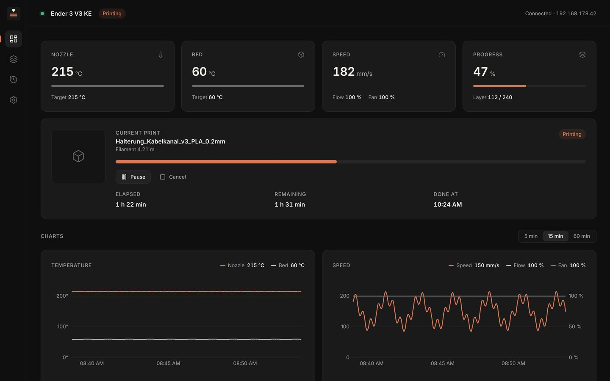
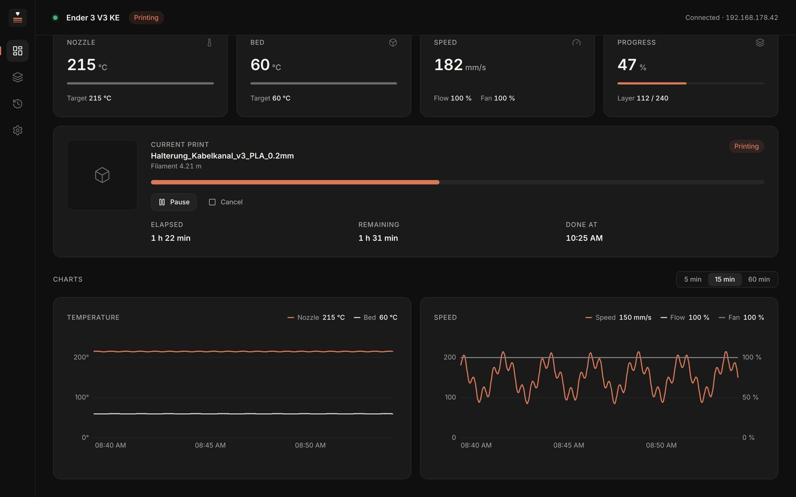
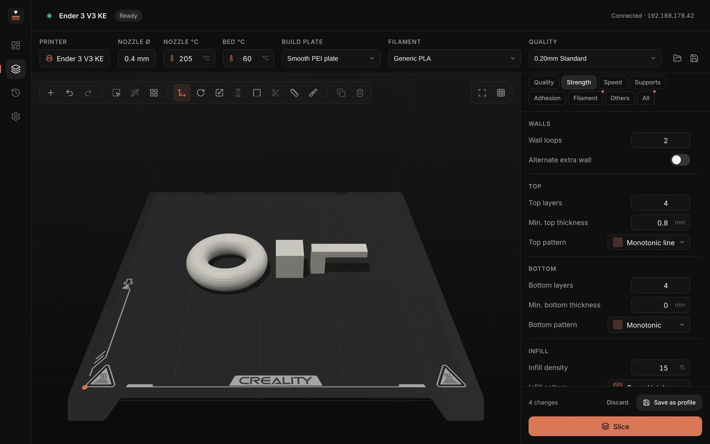
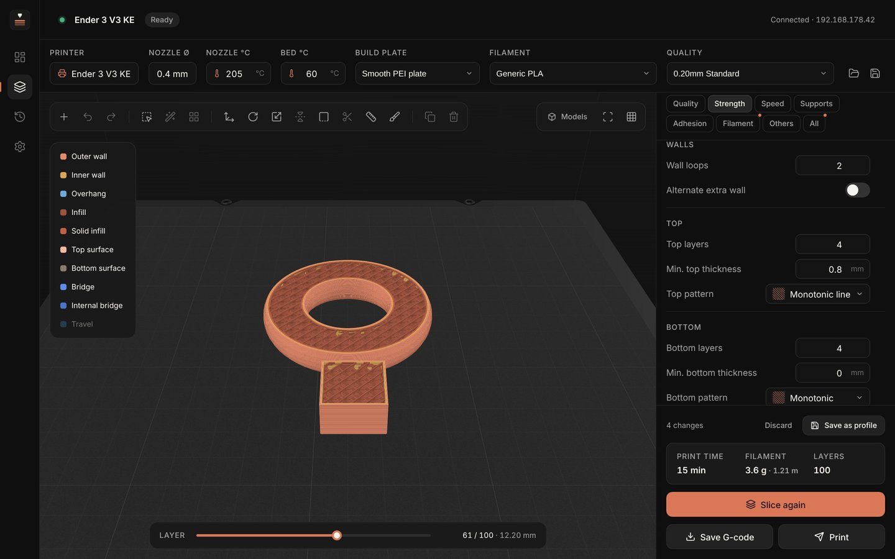

# Druckerwacht

🇬🇧 **English** · 🇩🇪 [Deutsch](README.de.md)

**A free desktop app to monitor, slice for and control your Creality Ender 3 V3 KE over Wi-Fi.**
Open source (AGPL-3.0) · macOS (Apple Silicon) and Linux (x86_64) · English and German

[**Download (Releases)**](https://github.com/pk1310oo/druckerwacht/releases/latest) · [Report a bug / request a feature](https://github.com/pk1310oo/druckerwacht/issues) · [Contributing](CONTRIBUTING.md)



*Druckerwacht* is German for “printer watch”. Built with Tauri 2, React and TypeScript; the backend is written in Rust.

- **Dashboard:** nozzle and bed (actual/target), speed, flow, fan, status, file, progress, layer, elapsed/remaining time and estimated finish
- **Live charts:** temperature plus speed, flow and fan over 5, 15 or 60 minutes
- **Print control:** pause, resume and cancel right from the app
- **Camera (optional):** MJPEG stream, e.g. the Nebula camera or a USB webcam
- **Notifications:** print finished, errors, connection lost
- **Print history:** the printer’s own job list plus every print the app followed
- **Connection:** automatic network discovery, automatic reconnect, connection status always visible
- **Slicer:** place models (STL/OBJ/3MF) on the original KE build plate, rotate, scale, paint supports and seams, save projects. All settings you know from Creality Print, a layer preview with round extrusion lines and **Print** straight to the printer. Powered by the OrcaSlicer engine (see below).

| Live charts | Slicer | Preview |
|---|---|---|
|  |  |  |

> **Beta.** The printer’s interface is not officially documented. Pause, resume, cancel and “Print” follow the
> behaviour of well-known integrations; feedback from real printers is very welcome. Druckerwacht is not an official Creality product.

---

## 1. Install

Download the latest version from [Releases](https://github.com/pk1310oo/druckerwacht/releases/latest).

**macOS (Apple Silicon, macOS 11+)**

1. Open the `.dmg` and drag **Druckerwacht** into **Applications**.
2. The app is not notarized by Apple, so allow it once in Terminal:

```bash
xattr -dr com.apple.quarantine /Applications/Druckerwacht.app
```

**Linux (Ubuntu 22.04+/Linux Mint 21+, x86_64)**

```bash
sudo apt install ./Druckerwacht_<version>_amd64.deb
```

Or run the AppImage directly:

```bash
chmod +x Druckerwacht_<version>_amd64.AppImage && ./Druckerwacht_<version>_amd64.AppImage
```

**For the slicer** you also need the free [OrcaSlicer](https://github.com/SoftFever/OrcaSlicer/releases). On macOS drag it into Applications; on Linux put the AppImage into `~/Applications/`. Druckerwacht finds it automatically – you never have to open it.

## 2. Getting started

1. **Settings → IP address:** enter it, or click **Search network**. The printer shows its IP under Settings → Network.
2. **Save.** The app connects right away and the dot in the header turns green.
3. **Settings → Language:** System, Deutsch or English.
4. Optional: add a camera URL, e.g. `http://<ip>:8080/?action=stream`. Without one, the camera stays hidden.

Settings are stored locally:

- macOS: `~/Library/Application Support/de.druckerwacht.app/settings.json`
- Linux: `~/.config/de.druckerwacht.app/settings.json`

## 3. Print control & printer history

**Pause / Resume / Cancel** appear on the dashboard below the progress bar while a print is running. Cancel asks for confirmation.
Commands (as used by Creality Print and the Home Assistant integration for K1/KE): `{"method":"set","params":{"pause":1}}`, `{"pause":0}`, `{"stop":1}`.
Pause is disabled during heating and leveling because the printer ignores it there.

**History → “From printer”** shows the list the printer keeps itself (last 50 prints with date, duration, filament and result) plus totals.

## 4. Slicer

Druckerwacht uses **OrcaSlicer as an invisible engine** – the same slicing core Creality Print is built on. The interface is our own.

| Tool | What it does |
|---|---|
| Select (V) | Like on your desktop: **drag on empty space** to select several parts (works in Select, Move, Rotate and Scale). Shift/Ctrl/Cmd-click adds or removes parts, **Ctrl/Cmd + A** selects all. Rotate the view with the **right mouse button** (Shift + right pans) or **Alt + drag** on a trackpad |
| ＋ Add | Load STL, OBJ or 3MF – or drop files onto the window |
| Auto orient | Finds the orientation with the largest contact area and least overhang |
| Arrange (A) | Spreads all models across the plate |
| Move (M) · Rotate (R) · Scale (S) | Drag the handle or type values in the object panel |
| Mirror | Along X, Y or Z |
| Lay on face (F) | Click the face that should be on the bed |
| Cut (C) | Horizontal cut at any height; keep one or both parts, optionally flip the top part. Cut faces are closed |
| Measure | Click two points on a model or the bed |
| Paint supports & seam (P) | Brush: **enforce** (green) or **block** (red) supports, seam **here** (blue) or **not here** (yellow), eraser |
| Undo / Redo | Ctrl/Cmd+Z, Ctrl/Cmd+Shift+Z (also Ctrl+Y) |
| Duplicate · Delete (Del) | |

*Settings:* Quality · Strength · Speed · Supports · Adhesion · Filament · Others, like in Creality Print. Infill patterns come with preview images. **All** lists every OrcaSlicer setting with search. Changed values are highlighted and can be saved as your own profile.

*Print:* The G-code is uploaded to the printer (`http://<IP>/upload/…`) and started via WebSocket (`opGcodeFile`), just like Creality Print and OrcaSlicer do. Before sending, the app checks that all temperatures stay within the printer’s limits and asks you to confirm the build plate is clear. After starting it waits for the printer to report the print.

*Projects:* open/save at the top right (Ctrl/Cmd+S). A `.druckerwacht` file contains all models with placement, painting, selected profiles and changes.

## 5. Build from source

**Requirements:** [Rust](https://rustup.rs) (stable), Node.js 22+ and npm.

- macOS: `xcode-select --install`
- Linux Mint 22 / Ubuntu 24.04:

```bash
sudo apt install -y build-essential curl wget file libssl-dev libxdo-dev libwebkit2gtk-4.1-dev libayatana-appindicator3-dev librsvg2-dev
```

Run in development mode:

```bash
npm install && npm run tauri dev
```

Tests:

```bash
cargo test --manifest-path src-tauri/Cargo.toml
```

Build packages (each on its own OS):

```bash
npm run tauri build -- --bundles dmg
```

```bash
npm run tauri build -- --bundles deb appimage
```

**Layout preview without a printer:** run `npm run dev` and open `http://localhost:1420/?preview=printing&lang=en` (other values: `idle`, `paused`, `preparing`, `connecting`, `reconnecting`, `history`).

## 6. How it works

```
src-tauri/src/
  adapter/creality.rs  WebSocket :9999, heartbeat, watchdog, reconnect with backoff
  model.rs             Tolerant parser → normalized PrinterStatus
  discovery.rs         Network discovery (local /24 networks, port 9999 + WebSocket check)
  printjob.rs          Upload, start, pause/resume/cancel, G-code safety check
  slicer.rs            Find and run OrcaSlicer, profiles, thumbnails, statistics
  i18n.rs              Backend messages in English/German
src/
  views/               Dashboard, Slicer, Camera, History, Settings
  slicer/              3D build plate (three.js), G-code preview, settings catalog (563 OrcaSlicer options)
  i18n/en.ts           English translation (key = German text; check with scripts/i18n-keys.py)
scripts/probe.mjs      Records the printer’s real interface for analysis
```

The printer interface (`ws://<IP>:9999`, the same one Creality Print uses) is undocumented. Field mapping for the Ender 3 V3 KE (model `F005`, firmware V1.1.0.17) is verified against real recordings in `src-tauri/fixtures/`. Unknown or missing fields never crash the app – it simply shows “–”.

**Other printers:** a new adapter in `src-tauri/src/adapter/` that implements `PrinterAdapter` is all it takes; the interface needs no changes. Next on the list: the Creality K1 series and Klipper/Moonraker. Recordings from your printer help a lot: `node scripts/probe.mjs <printer-ip> 600` (during a print).

## 7. Open source & contributing

Druckerwacht is free software under the **GNU Affero General Public License v3.0 or later** (see [`LICENSE`](LICENSE)).
You may use, modify and share it; modified versions must stay open source too.

Contributions are welcome: bug reports, recordings from other printers, translations and code – see [`CONTRIBUTING.md`](CONTRIBUTING.md).

## Credits

Made by **[pk1310oo](https://github.com/pk1310oo)**, with help from Claude.
Slicing engine and printer profiles: [OrcaSlicer](https://github.com/SoftFever/OrcaSlicer) (AGPL-3.0).
Druckerwacht is not an official Creality product.
