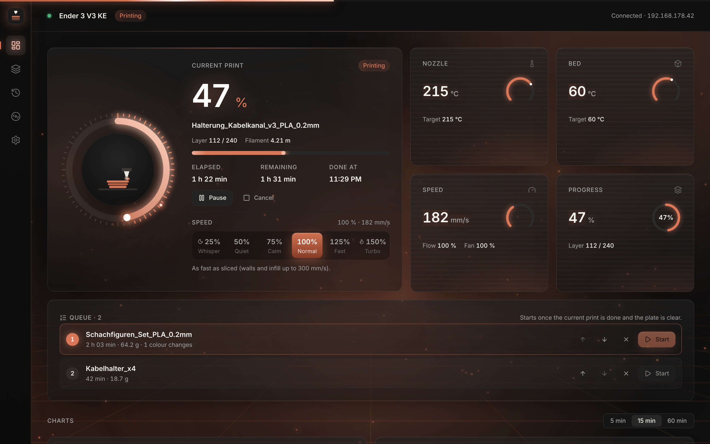
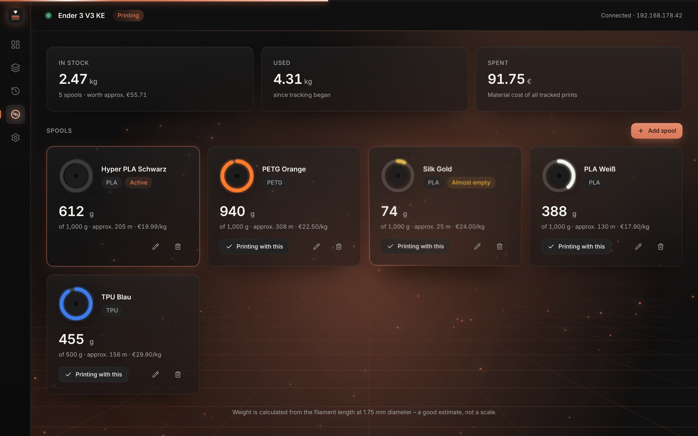

# Druckerwacht

🇬🇧 **English** · 🇩🇪 [Deutsch](README.de.md)

**The free all-in-one app for your 3D printers: watch, slice and control over Wi-Fi – made for the Creality Ender 3 V3 KE, and it also runs your K1, Klipper, OctoPrint and Prusa printers.**
Open source (AGPL-3.0) · **Windows, macOS and Linux** · English, German, Spanish, French and Polish

[**⬇ Download**](https://github.com/pk1310oo/druckerwacht/releases/latest) · [Website](https://pk1310oo.github.io/druckerwacht/) · [Report a bug / request a feature](https://github.com/pk1310oo/druckerwacht/issues) · [Contributing](CONTRIBUTING.md) · [☕ Support on Ko-fi](https://ko-fi.com/prisma76863)



## What it does

**Watch**
- Live dashboard: nozzle and bed with glowing gauges, speed, flow, fan, layer, remaining time and the real **finish time**
- Live charts over 5, 15 or 60 minutes, print history from the printer itself, **statistics** (success rate, print hours per week)
- Notifications on your computer – and optionally **on your phone** via the free ntfy app (done, error, paused, next print waiting)
- **macOS menu bar:** progress and finish time right next to the clock
- **Phone on Wi-Fi:** scan a QR code and see every printer live in your phone's browser – pause, resume, cancel, speed and light included, no app needed
- **Plain-language printer errors** and a **maintenance planner** that reminds you to clean the plate, lubricate rails or check belts by print hours

**AI failure watch**
- Detects spaghetti and detached prints in the camera picture and **pauses the print automatically** – runs entirely on your computer with the open Obico model, no cloud, no subscription

**Calibrate like a pro**
- Temperature, **flow**, **retraction** and **speed towers** plus a **first-layer test** – the app builds the model and writes the values into the G-code; click the best block to put its value into your profile
- **Remembered Z offset**: tune the first layer once, it's applied to every print automatically
- **Filament assistant** with proven starting values (PLA, PETG, TPU, ABS, ASA …) and a **duration comparison** for 50–150 % speed

**Many printers**
- Creality (Ender 3 V3 KE, K1, K1C, K1 Max), every **Klipper** printer with Moonraker (Voron, Sovol, Elegoo Neptune 4, Qidi …), **OctoPrint** (practically any Marlin printer) and **Prusa** via PrusaLink (MK4, MK3.9, Core One, Mini, XL)
- The network search finds all of them; every printer is watched at the same time, switch with one click

**Control**
- Pause, resume, cancel
- **Tools card:** home, **bed leveling with save**, **PID tuning**, preheat (PLA/PETG/ABS/TPU), load/unload filament, Z offset babystepping during the first layer, fan, light, motors off
- Send any finished G-code file and print it
- **Find models** on Printables, Thingiverse and MakerWorld – the download lands straight on the plate
- **Print again** from the history with one click – the app keeps a copy of your last 15 prints
- **Night mode:** quiet 50 % between 22:00 and 07:00, back to your speed in the morning
- **Live speed** from 25 % *Whisper* to 150 % *Turbo* – the first layer always stays at max. 50 mm/s so it sticks
- **Print queue:** line up sliced prints and start the next one with a click once the plate is clear

**Slice**
- OrcaSlicer engine with the official KE profiles, every setting, layer preview
- Paint supports and seams, cut, measure, box-select several parts
- **Colour changes:** mark any layer – the printer pauses there for the next filament
- **Temperature tower** with one click: the app builds the model and writes the temperature change into each block
- The print dialog shows when the print will be **done** – with a 🌙 if that's in the middle of the night

**Filament stock**
- Your spools with what's left, metres and price per kg
- Every print is subtracted automatically, the **cost per print** is shown before you print
- Warns you **before** a spool runs out mid-print



**Comfort:** **voice announcements** (start, 25/50/75 %, colour change, done) · **print calendar with electricity cost** · **share image** of finished prints for Instagram & TikTok · on first start the app searches your network and sets up the printer with one click · **backup & restore** of all printers, settings, spools and maintenance status.

**Looks:** calm neon grid background, glowing progress ring, 3D cards, seven colour themes – or switch effects to *Subtle* on slower computers.

> **Beta.** The printer's interface is not officially documented; feedback from real printers is very welcome.
> Druckerwacht is not an official Creality product.

---

## 1. Install

Download the latest version from [Releases](https://github.com/pk1310oo/druckerwacht/releases/latest).

**Windows 10/11**

Run `Druckerwacht_<version>_x64-setup.exe`. If SmartScreen warns (“unknown publisher”), click **More info → Run anyway** – the app is not code-signed yet.

**macOS (Apple Silicon, macOS 11+)**

1. Open the `.dmg` and drag **Druckerwacht** into **Applications**.
2. The app is not notarized by Apple, so allow it once in Terminal:

   ```bash
   xattr -dr com.apple.quarantine /Applications/Druckerwacht.app
   ```

**Linux (Ubuntu 22.04+/Linux Mint 21+, x86_64)**

```bash
sudo apt install ./Druckerwacht_<version>_amd64.deb
```

Or use the `.AppImage`.

**For the slicer** you also need the free [OrcaSlicer](https://github.com/SoftFever/OrcaSlicer/releases): install it on Windows, drag it into Applications on macOS, or put the AppImage into `~/Applications/` on Linux. Druckerwacht finds it automatically – you never have to open it.

## 2. Getting started

1. **Settings → IP address:** enter it, or click **Search network**. The printer shows its IP under Settings → Network.
2. **Save.** The app connects right away and the dot in the header turns green.
3. Optional: **Settings → To your phone** for push messages, **Filament** to add your spools, **Appearance** for colours and effects.

## 3. Print control & printer history

**Pause / Resume / Cancel** appear on the dashboard below the progress bar while a print is running. Cancel asks for confirmation.
Commands (as used by Creality Print and the Home Assistant integration for K1/KE): `{"method":"set","params":{"pause":1}}`, `{"pause":0}`, `{"stop":1}`.
Pause is disabled during heating and leveling because the printer ignores it there.

**History → “From printer”** shows the list the printer keeps itself (last 50 prints with date, duration, filament and result) plus totals.

## 4. Slicer

Druckerwacht uses **OrcaSlicer as an invisible engine** – the same slicing core Creality Print is built on. The interface is our own.

| Tool | What it does |
|---|---|
| Select (V) | Like on your desktop: **drag on empty space** to select several parts (works in Select, Move, Rotate and Scale). Shift/Ctrl/Cmd-click adds or removes parts, **Ctrl/Cmd + A** selects all. Rotate the view with the **right mouse button** (Shift + right pans) or **Alt + drag** on a trackpad |
| ＋ Add | Load STL, OBJ or 3MF – or drop files onto the window |
| Auto orient | Finds the orientation with the largest contact area and least overhang |
| Arrange (A) | Spreads all models across the plate |
| Move (M) · Rotate (R) · Scale (S) | Drag the handle or type values in the object panel |
| Mirror | Along X, Y or Z |
| Lay on face (F) | Click the face that should be on the bed |
| Cut (C) | Horizontal cut at any height; keep one or both parts, optionally flip the top part. Cut faces are closed |
| Measure | Click two points on a model or the bed |
| Paint supports & seam (P) | Brush: **enforce** (green) or **block** (red) supports, seam **here** (blue) or **not here** (yellow), eraser |
| Undo / Redo | Ctrl/Cmd+Z, Ctrl/Cmd+Shift+Z (also Ctrl+Y) |
| Duplicate · Delete (Del) | |

*Settings:* Quality · Strength · Speed · Supports · Adhesion · Filament · Others, like in Creality Print. Infill patterns come with preview images. **All** lists every OrcaSlicer setting with search. Changed values are highlighted and can be saved as your own profile.

*Print:* The G-code is uploaded to the printer (`http://<IP>/upload/…`) and started via WebSocket (`opGcodeFile`), just like Creality Print and OrcaSlicer do. Before sending, the app checks that all temperatures stay within the printer’s limits and asks you to confirm the build plate is clear. After starting it waits for the printer to report the print.

*Projects:* open/save at the top right (Ctrl/Cmd+S). A `.druckerwacht` file contains all models with placement, painting, selected profiles and changes.

## 5. Build from source

**Requirements:** [Rust](https://rustup.rs) (stable), Node.js 22+ and npm.

- macOS: `xcode-select --install`
- Linux Mint 22 / Ubuntu 24.04:

```bash
sudo apt install -y build-essential curl wget file libssl-dev libxdo-dev libwebkit2gtk-4.1-dev libayatana-appindicator3-dev librsvg2-dev
```

Run in development mode:

```bash
npm install && npm run tauri dev
```

Tests:

```bash
cargo test --manifest-path src-tauri/Cargo.toml
```

Build packages (each on its own OS):

```bash
npm run tauri build -- --bundles dmg
```

```bash
npm run tauri build -- --bundles deb appimage
```

**Layout preview without a printer:** run `npm run dev` and open `http://localhost:1420/?preview=printing&lang=en` (other values: `idle`, `paused`, `preparing`, `connecting`, `reconnecting`, `history`).

## 6. How it works

```
src-tauri/src/
  adapter/creality.rs  WebSocket :9999, heartbeat, watchdog, reconnect with backoff
  model.rs             Tolerant parser → normalized PrinterStatus
  discovery.rs         Network discovery (local /24 networks, port 9999 + WebSocket check)
  printjob.rs          Upload, start, pause/resume/cancel, G-code safety check
  slicer.rs            Find and run OrcaSlicer, profiles, thumbnails, statistics
  i18n.rs              Backend messages in English/German
src/
  views/               Dashboard, Slicer, History, Filament, Settings
  slicer/              3D build plate (three.js), G-code preview, settings catalog (563 OrcaSlicer options)
  i18n/en.ts           English translation (key = German text; check with scripts/i18n-keys.py)
scripts/probe.mjs      Records the printer’s real interface for analysis
```

The printer interface (`ws://<IP>:9999`, the same one Creality Print uses) is undocumented. Field mapping for the Ender 3 V3 KE (model `F005`, firmware V1.1.0.17) is verified against real recordings in `src-tauri/fixtures/`. Unknown or missing fields never crash the app – it simply shows “–”.

**Other printers:** a new adapter in `src-tauri/src/adapter/` that implements `PrinterAdapter` is all it takes; the interface needs no changes. Next on the list: the Creality K1 series and Klipper/Moonraker. Recordings from your printer help a lot: `node scripts/probe.mjs <printer-ip> 600` (during a print).

## 7. Open source & contributing

Druckerwacht is free software under the **GNU Affero General Public License v3.0 or later** (see [`LICENSE`](LICENSE)).
You may use, modify and share it; modified versions must stay open source too.

Contributions are welcome: bug reports, recordings from other printers, translations and code – see [`CONTRIBUTING.md`](CONTRIBUTING.md).

## Credits

Made by **[pk1310oo](https://github.com/pk1310oo)**, with help from Claude.
Slicing engine and printer profiles: [OrcaSlicer](https://github.com/SoftFever/OrcaSlicer) (AGPL-3.0).
Druckerwacht is not an official Creality product.
